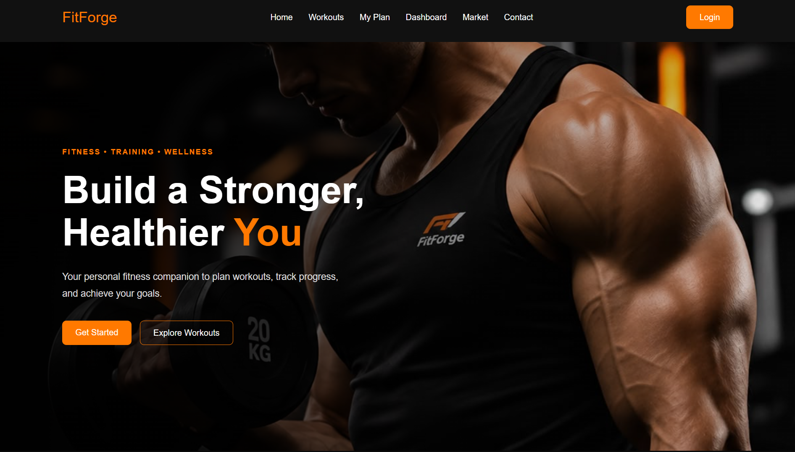
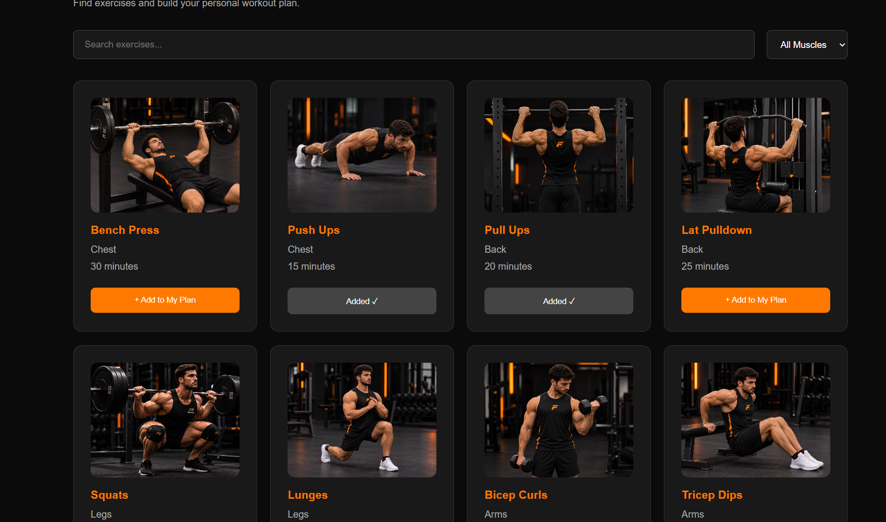
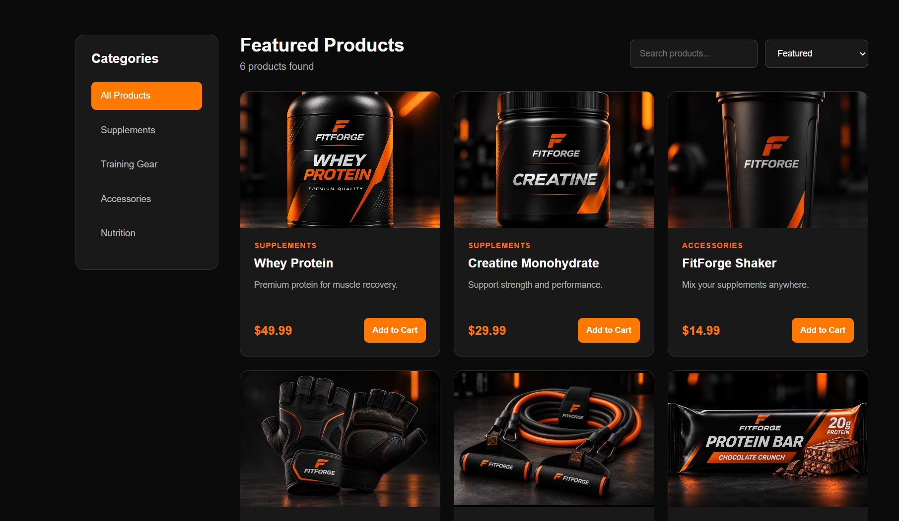
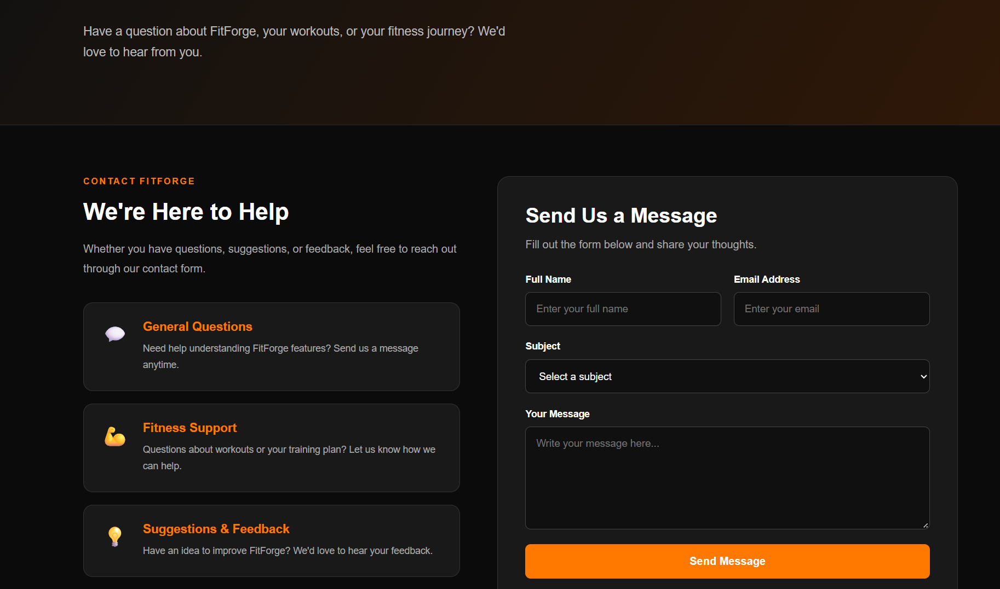
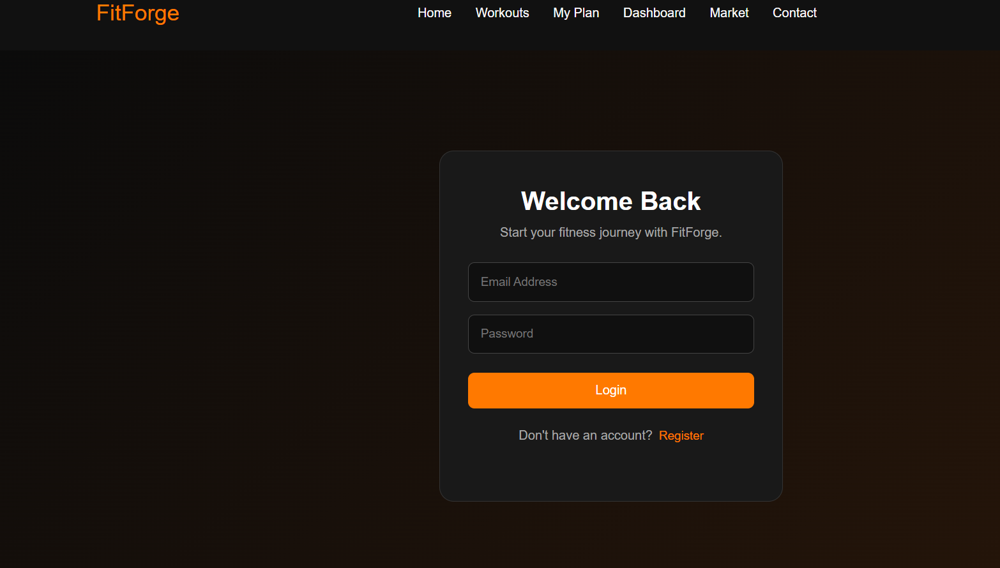

# FitForge 2 — Fitness & Workout Tracking Web Application

A responsive fitness and workout tracking web application built with ReactJS for the CSCI426 Advanced Web Programming course.

## Live Website

**[Visit FitForge 2](https://fitforge-2.vercel.app)**

## Project Overview

FitForge 2 allows users to explore exercises, search and filter workouts, create personalized workout plans, monitor workout progress, and browse fitness-related products.

The application features a modern, responsive interface with a black and orange fitness-inspired design.

## Features

- **Home:** Introduces the application and its main features.
- **Workouts:** Displays exercises with images, muscle groups, and workout durations. Users can search and filter exercises.
- **My Plan:** Allows users to add and remove exercises from their personal workout plan.
- **Dashboard:** Provides an overview of workout activities and progress.
- **Market:** Displays fitness products and their details.
- **Contact:** Provides a contact page.
- **Login / Register:** Provides a user authentication interface.

## Website Screenshots

### 1. Home Page



### 2. Workouts Page



### 3. My Plan Page


### 4. Dashboard Page


### 5. Market Page



### 6. Contact Page



### 7. Login / Register Page



## Technologies Used

- ReactJS
- JavaScript (ES6)
- HTML5
- CSS3
- React Router
- React Hooks (`useState`, `useEffect`, `useContext`)
- Context API
- Local Storage
- Git and GitHub
- Vercel

## Installation and Setup

1. Install Node.js and npm.

2. Clone the repository:

   ```bash
   git clone https://github.com/Ali1122331/fitforge-2.git
   ```

3. Open the project folder:

   ```bash
   cd fitforge-2
   ```

4. Install dependencies:

   ```bash
   npm install
   ```

5. Start the development server:

   ```bash
   npm start
   ```

6. Open http://localhost:3000 in your browser.

## Project Structure

```text
fitforge-2/
├── public/
├── screenshots/
│   ├── home.png
│   ├── workouts.png
│   ├── workout plan.png
│   ├── fitness dashboard.png
│   ├── market.png
│   ├── contact.png
│   └── login.png
├── src/
│   ├── assets/
│   │   └── images/
│   ├── components/
│   ├── context/
│   ├── pages/
│   ├── App.js
│   └── App.css
├── package.json
└── README.md
```

## Deployment

The application is deployed using Vercel.

**Live Website:** https://fitforge-2.vercel.app

**GitHub Repository:** https://github.com/Ali1122331/fitforge-2

## Academic Information

**Course:** CSCI426 — Advanced Web Programming

**Project:** Phase 1 — Front-End Implementation

**Project Name:** FitForge 2
